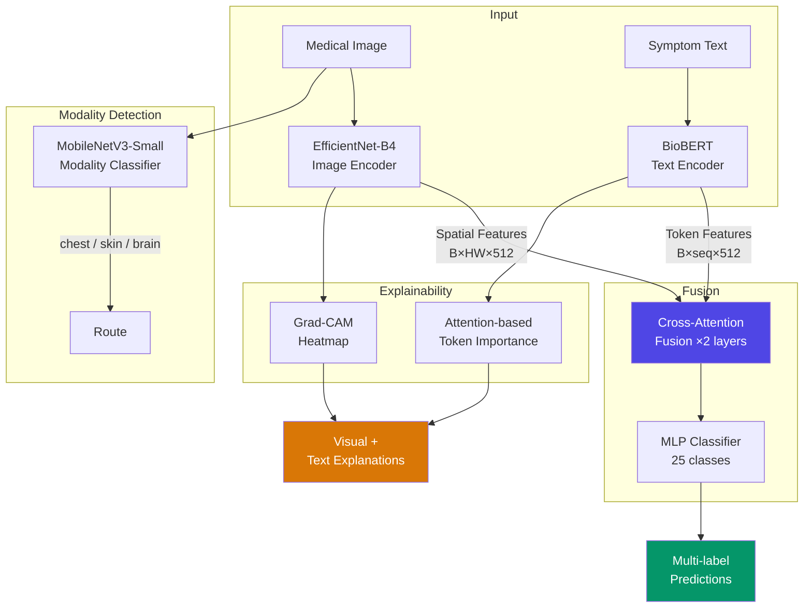

# Multi-Modal Disease Detection System

A production-grade, end-to-end **multi-modal medical disease detection** system that combines **medical image analysis** (chest X-rays, dermoscopy, brain MRI) with **clinical symptom text understanding** (BioBERT) via **cross-attention fusion** for 25-class multi-label diagnosis with full explainability.

## Architecture



## Supported Diseases (25 classes)

| # | Modality | Diseases |
|---|----------|----------|
| 0–13 | **Chest X-ray** | Atelectasis, Cardiomegaly, Effusion, Infiltration, Mass, Nodule, Pneumonia, Pneumothorax, Consolidation, Edema, Emphysema, Fibrosis, Pleural Thickening, Hernia |
| 14–20 | **Skin (Dermoscopy)** | Melanoma, Melanocytic Nevi, Basal Cell Carcinoma, Actinic Keratosis, Benign Keratosis, Dermatofibroma, Vascular Lesion |
| 21–24 | **Brain MRI** | Glioma, Meningioma, Pituitary Tumor, No Tumor |

## Project Structure

```
multimodalAI/
├── api/                            # FastAPI backend
│   ├── main.py                     # Application entry point
│   ├── schemas.py                  # Pydantic request/response models
│   ├── config.py                   # YAML config loader (singleton)
│   ├── requirements.txt
│   ├── models/                     # PyTorch model definitions
│   │   ├── image_encoder.py        # EfficientNet-B4 wrapper
│   │   ├── text_encoder.py         # BioBERT wrapper
│   │   ├── fusion.py               # Cross-attention & concat fusion
│   │   ├── multimodal.py           # End-to-end detector
│   │   └── modality_classifier.py  # MobileNetV3 auto-routing
│   ├── preprocessing/
│   │   ├── image_transforms.py     # Image loading & augmentation
│   │   └── text_processing.py      # Medical text normalization
│   └── explainability/
│       ├── gradcam.py              # Grad-CAM heatmap generation
│       └── text_attention.py       # Token importance extraction
├── frontend/                       # React + Vite + Tailwind
│   ├── src/
│   │   ├── App.jsx                 # Main app with state management
│   │   ├── api.js                  # Axios API client
│   │   └── components/
│   │       ├── ImageUpload.jsx     # Drag & drop image upload
│   │       ├── SymptomInput.jsx    # Symptom text input + examples
│   │       ├── PredictionResults.jsx # Confidence bar chart
│   │       ├── HeatmapViewer.jsx   # Grad-CAM overlay toggle
│   │       └── ExplanationPanel.jsx # Token importance display
│   └── package.json
├── kaggle_notebooks/               # Self-contained training notebooks
│   ├── image_training.ipynb        # EfficientNet-B4 + MobileNetV3
│   ├── text_training.ipynb         # BioBERT + synthetic symptoms
│   └── multimodal_training.ipynb   # Cross-attention fusion
├── configs/
│   └── model_config.yaml           # Central configuration
├── models/                         # Trained weight files (.pth)
├── utils/
│   ├── losses.py                   # Focal loss, weighted BCE
│   ├── metrics.py                  # F1, ROC-AUC, threshold optimization
│   ├── augmentation.py             # Modality-aware transforms
│   └── synthetic_symptoms.py       # Symptom text generation
├── scripts/
│   ├── download_models.py          # Download weights from Kaggle
│   └── setup.sh                    # One-command project setup
└── README.md
```

## Quick Start

### 1. Clone & Setup

```bash
git clone <repo-url> multimodalAI
cd multimodalAI

# Option A: Run the setup script
bash scripts/setup.sh

# Option B: Manual setup
python -m venv venv
source venv/bin/activate  # or venv\Scripts\activate on Windows
pip install -r api/requirements.txt

cd frontend && npm install && cd ..
```

### 2. Train on Kaggle

Upload the three notebooks to Kaggle (GPU runtime, Internet enabled):

1. **`image_training.ipynb`** — Trains EfficientNet-B4 image encoder + MobileNetV3 modality classifier
   - Add datasets: `nih-chest-xrays`, `skin-cancer-mnist-ham10000`, `brain-tumor-mri-dataset`
   - Outputs: `image_encoder.pth`, `image_head.pth`, `modality_classifier.pth`

2. **`text_training.ipynb`** — Fine-tunes BioBERT on synthetic clinical symptom descriptions
   - No datasets needed (generates synthetic data)
   - Outputs: `text_encoder.pth`, `text_head.pth`, `tokenizer/`

3. **`multimodal_training.ipynb`** — Trains cross-attention fusion combining both encoders
   - Upload outputs from notebooks 1 & 2 as a Kaggle dataset
   - Add the same image datasets
   - Outputs: `fusion_model.pth`, `multimodal_config.json`

### 3. Download Weights

```bash
# From Kaggle
python scripts/download_models.py --kaggle-dataset your-username/multimodal-weights

# Or from a local directory
python scripts/download_models.py --local-dir /path/to/kaggle/output
```

### 4. Run Locally

```bash
# Terminal 1: Start API server
python -m uvicorn api.main:app --host 0.0.0.0 --port 8000 --reload

# Terminal 2: Start frontend
cd frontend && npm run dev
```

Open **http://localhost:5173** in your browser.

## API Endpoints

| Method | Path | Description |
|--------|------|-------------|
| `GET` | `/health` | Health check + model load status |
| `GET` | `/labels` | List of all 25 disease labels |
| `POST` | `/predict` | Single-mode prediction (auto-detects image-only or text-only) |
| `POST` | `/predict-multimodal` | Full multimodal prediction (requires both image + text) |

### Example: cURL

```bash
# Image only
curl -X POST http://localhost:8000/predict \
  -F "image=@chest_xray.png"

# Text only
curl -X POST http://localhost:8000/predict \
  -F "symptoms=A 65-year-old male with productive cough, fever, and dyspnea"

# Multimodal
curl -X POST http://localhost:8000/predict-multimodal \
  -F "image=@chest_xray.png" \
  -F "symptoms=A 65-year-old male with productive cough, fever"
```

## Key Technical Decisions

| Decision | Choice | Rationale |
|----------|--------|-----------|
| Image backbone | EfficientNet-B4 | 1792-dim features, good accuracy/efficiency tradeoff |
| Text encoder | BioBERT (dmis-lab/biobert-v1.1) | Pre-trained on biomedical literature |
| Fusion strategy | Bidirectional cross-attention (2 layers, 8 heads) | Text attends to image spatial features and vice versa |
| Loss function | Focal Loss (α=0.25, γ=2.0) | Handles severe class imbalance (Hernia at 0.16%) |
| Training strategy | Frozen → unfrozen (differential LR) | Prevents catastrophic forgetting of pre-trained features |
| Inference | CPU-only | No GPU requirement for deployment |
| Modality detection | MobileNetV3-Small | Lightweight auto-routing of images |
| Explainability | Grad-CAM + attention weights | Visual + textual explanations |

## Datasets

| Dataset | Size | Classes | Usage |
|---------|------|---------|-------|
| [NIH ChestX-ray14](https://www.kaggle.com/datasets/nih-chest-xrays/data) | 45.1 GB (30% subset used) | 14 | Chest X-ray classification |
| [HAM10000](https://www.kaggle.com/datasets/kmader/skin-cancer-mnist-ham10000) | 2.9 GB | 7 | Skin lesion classification |
| [Brain Tumor MRI](https://www.kaggle.com/datasets/masoudnickparvar/brain-tumor-mri-dataset) | 93 MB | 4 | Brain tumor classification |
| Synthetic symptoms | Generated at runtime | 25 | Clinical text descriptions |

## License

This project is for **research and educational purposes only**. Not intended for clinical diagnosis.

Medical image datasets are subject to their respective licenses. See each dataset page on Kaggle for details.
