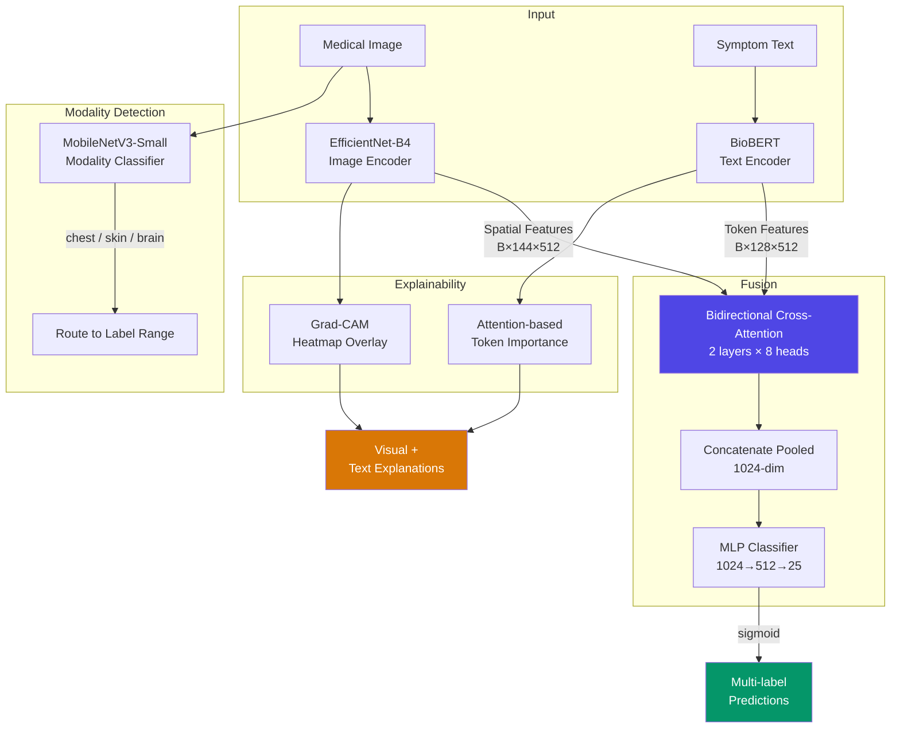

# Multi-Modal Disease Detection System

<div align="center">

**Multi-Modal Medical Diagnosis Prototype with Cross-Attention Fusion**

Combines **medical image analysis** (chest X-rays, dermoscopy, brain MRI) with **clinical symptom text understanding** (BioBERT) via **bidirectional cross-attention fusion** for 25-class multi-label diagnosis with full visual and textual explainability.

[](https://github.com/ARRY7686/Multi-Modal-Disease-Detection-System/actions/workflows/ci.yml)
[](https://www.python.org/)
[](https://pytorch.org/)
[](https://fastapi.tiangolo.com/)
[](https://react.dev/)
[](https://vitejs.dev/)
[](https://tailwindcss.com/)

**[Live demo](https://huggingface.co/spaces/Arry7868/Multi-Modal-Disease-Detection)** · **[Weights](https://huggingface.co/Arry7868/multimodal-disease-detection)**

</div>

---

## Table of Contents

- [Highlights](#highlights)
- [System Architecture](#system-architecture)
- [Model Performance](#model-performance)
- [Supported Diseases (25 Classes)](#supported-diseases-25-classes)
- [Project Structure](#project-structure)
- [Quick Start](#quick-start)
  - [Prerequisites](#prerequisites)
  - [Installation](#installation)
  - [Training on Kaggle](#training-on-kaggle)
  - [Running Locally](#running-locally)
- [API Reference](#api-reference)
- [Frontend Features](#frontend-features)
- [Model Architecture Deep Dive](#model-architecture-deep-dive)
  - [Image Encoder](#image-encoder)
  - [Text Encoder](#text-encoder)
  - [Cross-Attention Fusion](#cross-attention-fusion)
  - [Modality Classifier](#modality-classifier)
- [Explainability](#explainability)
- [Training Pipeline](#training-pipeline)
- [Configuration](#configuration)
- [Technical Decisions](#technical-decisions)
- [Datasets](#datasets)
- [Disclaimer](#disclaimer)

---

## Highlights

- **Multi-modal inference** — Accepts medical images, clinical symptom text, or both simultaneously
- **25-class multi-label output** spanning 3 medical imaging modalities (chest, skin, brain)
- **Bidirectional cross-attention fusion** — Image and text representations attend to each other across 2 transformer layers with 8 attention heads
- **Automatic modality routing** — MobileNetV3-Small classifier auto-detects if an uploaded image is a chest X-ray, skin lesion photograph, or brain MRI scan (with a color-statistics heuristic fallback)
- **Dual explainability** — Grad-CAM heatmaps for image regions + attention-weighted token importance for symptom text
- **Leak-free evaluation** — Paired text is real patient metadata, splits are patient-, lesion- and duplicate-disjoint, and the test sets are scored once with bootstrap confidence intervals
- **Calibrated outputs** — Temperatures and per-class decision thresholds fitted on validation, reported per prediction
- **One-script training** — `training/` trains the image-only, text-only and fusion heads together and imports the API's model code, so the weights always load
- **Production-ready API** — FastAPI backend with Pydantic validation, CORS, upload size limits, clear 4xx errors, and CPU inference
- **Modern frontend** — React 18 + Vite + Tailwind CSS with drag-and-drop upload, interactive heatmap overlay, and highlighted symptom tokens

---

## System Architecture



**Data flow summary:**

1. **Image path** — Input image (380×380) → EfficientNet-B4 backbone → spatial features (B, 144, 512) + pooled embedding (B, 512)
2. **Text path** — Symptom text → BioBERT tokenizer (max 128 tokens) → token features (B, seq, 512) + pooled embedding (B, 512)
3. **Fusion** — Bidirectional cross-attention (image attends to text; text attends to image) × 2 layers → mean-pooled → concatenated 1024-dim vector → MLP → 25 sigmoid outputs
4. **Modality routing** — MobileNetV3-Small classifies the image modality (chest/skin/brain) to filter the 25-class output to the relevant disease subset

---

## Model Performance

All numbers are from **held-out test sets that no training or tuning step saw**: the NIH
ChestX-ray14 official test list (patient-disjoint), a HAM10000 hold-out grouped by `lesion_id`,
and a brain MRI hold-out with duplicate images grouped (see [below](#brain-mri-duplicates)).
The paired text is real recorded metadata (age, sex, X-ray view, lesion site), never the label.
Temperatures and per-class thresholds were fitted on validation only, and the test sets were
evaluated once. 95% bootstrap confidence intervals (500 resamples) in brackets.

| Mode | Chest macro AUROC | Skin balanced acc. | Skin macro AUROC | Brain accuracy | Brain macro AUROC | ECE |
|---|---|---|---|---|---|---|
| **multimodal** | 0.755 [0.751, 0.759] | 0.608 [0.551, 0.671] | 0.954 [0.942, 0.965] | 0.958 | 0.992 [0.986, 0.997] | 0.011 |
| **image only** | **0.759** [0.754, 0.763] | **0.640** [0.584, 0.700] | **0.957** | 0.945 | **0.993** | 0.013 |
| **text only** | 0.597 [0.591, 0.602] | 0.202 [0.191, 0.214] | 0.774 | 0.304 | 0.500 | 0.028 |

Test sets: 25,596 chest X-rays, 1,441 skin lesion photos, 457 brain MRIs. Model: EfficientNet-B4
(380 px) + BioBERT with cross-attention fusion, trained for 8 epochs on 30% of the NIH training
patients, all of HAM10000 train and brain train (about 2.5 h on one Kaggle T4).
Modality classifier test accuracy: 0.9999.

**What these numbers say**

- **The image does almost all the work.** Image-only and multimodal scores are within each other's
  confidence intervals in every column. The recorded metadata adds no measurable accuracy on top of
  the image: chest X-rays come with only age, sex and view position, and brain MRIs with nothing.
- **Metadata alone is weak but not empty.** Age, sex and lesion site rank skin diagnoses at 0.77
  AUROC (site and age genuinely differ between melanoma, nevi and keratoses), and age plus view
  position give 0.60 on chest. Brain text-only is exactly chance (0.500), as it must be: every brain
  scan has the same placeholder text, which confirms the text carries no hidden label.
- **The model is calibrated out of the box.** The fitted temperatures are 0.99-1.02, and the
  expected calibration error is 0.011 before and after scaling, so the confidences the API returns
  can be read as probabilities.
- **On average the details add nothing; on single cases they can dominate.** Example: a clinical photo of a
  melanoma scores Melanoma 43.6% (above threshold) image-only, but with only "21-year-old male." as the details the
  fused model says Melanocytic Nevi 90.9% and Melanoma 3.1%. Adding a lesion site ("Lesion on the back.") brings
  Melanoma back to 68.5%. The fused model has learned HAM10000's age and site patterns (melanoma is rare in young
  patients) strongly enough to overrule the image. The app warns whenever the details change the top finding; the
  fix belongs in training (more text dropout, or capping how far the details can move the image's scores).
- **Chest is the hard part.** 0.755 macro AUROC on the official patient-disjoint split, from 30% of
  the training patients. The best findings are Hernia (0.85), Pneumothorax (0.82) and Edema (0.81);
  the worst are Nodule (0.68) and Infiltration (0.70). Training on all patients is the main lever
  (`--chest-train-fraction 1.0`).

<details>
<summary>Chest per-class AUROC</summary>

| Finding | Multimodal | Image only |
|---|---|---|
| Atelectasis | 0.734 | 0.738 |
| Cardiomegaly | 0.751 | 0.783 |
| Effusion | 0.797 | 0.800 |
| Infiltration | 0.696 | 0.695 |
| Mass | 0.737 | 0.727 |
| Nodule | 0.679 | 0.687 |
| Pneumonia | 0.699 | 0.690 |
| Pneumothorax | 0.816 | 0.823 |
| Consolidation | 0.715 | 0.710 |
| Edema | 0.811 | 0.818 |
| Emphysema | 0.796 | 0.801 |
| Fibrosis | 0.765 | 0.776 |
| Pleural Thickening | 0.719 | 0.722 |
| Hernia | 0.855 | 0.850 |

</details>

### Training Convergence

Validation macro AUROC over all 25 labels (chest, skin and brain pooled), 1 epoch with frozen
backbones and then 7 fine-tuned:

| Epoch | Train loss | Multimodal | Image only | Text only |
|---|---|---|---|---|
| 1 (frozen) | 0.420 | 0.815 | 0.828 | 0.576 |
| 2 | 0.356 | 0.864 | 0.882 | 0.596 |
| 4 | 0.318 | 0.897 | 0.906 | 0.622 |
| 6 | 0.294 | 0.909 | 0.916 | 0.625 |
| 8 | 0.288 | 0.910 | 0.918 | 0.625 |

### Brain MRI duplicates

The official `Testing/` folder of the brain tumour dataset cannot be used as a test set: **255 of
its 394 images are copies of training images** (re-encoded, 99% pixel-identical, the same label in
253 of 255 cases), including every one of the 105 `no_tumor` test images. A model evaluated on it is
partly graded on images it trained on. The pipeline pools `Training/` and `Testing/`, groups
near-identical images by perceptual hash (dHash), keeps each group inside one split, and drops the
29 images whose copies carry different labels.

### Why the earlier numbers were replaced

The first version of this project reported a multimodal macro AUROC of 0.989 and a perfect 1.000 on
skin and brain. Those numbers measured label leakage, not diagnosis: each image's symptom text was
generated from that image's own label, in training and evaluation, so the model could read the
answer from the text (text-only AUROC was 0.999). The splits also let the same patient, lesion or
duplicated MRI appear in both training and test. The current pipeline removes all three leaks, and
`tests/test_training.py` checks that no label word appears in any paired text and that no patient,
lesion or duplicate group crosses splits.

---

## Supported Diseases (25 Classes)

| Index Range | Modality | Diseases | Dataset |
|-------------|----------|----------|---------|
| 0–13 | **Chest X-ray** | Atelectasis, Cardiomegaly, Effusion, Infiltration, Mass, Nodule, Pneumonia, Pneumothorax, Consolidation, Edema, Emphysema, Fibrosis, Pleural Thickening, Hernia | NIH ChestX-ray14 |
| 14–20 | **Skin (Dermoscopy)** | Melanoma, Melanocytic Nevi, Basal Cell Carcinoma, Actinic Keratosis, Benign Keratosis, Dermatofibroma, Vascular Lesion | HAM10000 |
| 21–24 | **Brain MRI** | Glioma, Meningioma, Pituitary Tumor, No Tumor | Brain Tumor Classification (MRI) |

---

## Project Structure

```
multimodalAI/
├── api/                              # FastAPI backend
│   ├── __init__.py
│   ├── main.py                       # FastAPI app factory + endpoints (thin HTTP layer)
│   ├── service.py                    # InferenceService: model loading, routing, prediction, explanations
│   ├── schemas.py                    # Pydantic request/response models
│   ├── config.py                     # YAML config loader (singleton pattern)
│   ├── requirements.txt              # Python dependencies
│   ├── models/                       # PyTorch model definitions
│   │   ├── __init__.py
│   │   ├── image_encoder.py          # EfficientNet-B4 (1792→512 projection)
│   │   ├── text_encoder.py           # BioBERT (768→512 projection)
│   │   ├── fusion.py                 # Cross-attention blocks + classifier
│   │   ├── multimodal.py             # End-to-end MultiModalDetector
│   │   └── modality_classifier.py    # MobileNetV3-Small (3-class)
│   ├── preprocessing/
│   │   ├── __init__.py
│   │   ├── image_transforms.py       # Resize, normalize, inference transforms
│   │   └── text_processing.py        # Medical text tokenization (BioBERT)
│   └── explainability/
│       ├── __init__.py
│       ├── gradcam.py                # Grad-CAM heatmap generation
│       └── text_attention.py         # Token importance via attention weights
│
├── frontend/                         # React + Vite + Tailwind CSS
│   ├── index.html
│   ├── package.json
│   ├── vite.config.js
│   ├── tailwind.config.js            # Dark theme tokens (surfaces, ink, mode colours)
│   ├── postcss.config.js
│   └── src/
│       ├── App.jsx                   # Tabs (Analyze / Model card / About), analysis flow, history
│       ├── api.js                    # Axios API client (same-origin in Docker)
│       ├── main.jsx                  # React entry point
│       ├── index.css                 # Tailwind base + component classes, print styles
│       ├── lib/domain.js             # Labels, mode colours, training-format detail sentences
│       ├── lib/hotspot.js            # Finds the hottest region of a Grad-CAM overlay
│       ├── hooks/useHistory.js       # Recent analyses in localStorage, thumbnails
│       └── components/
│           ├── Header.jsx            # Hairline tabs, status, source link
│           ├── Stage.jsx             # Centre stage: scan / Grad-CAM, hotspot, callouts and leader lines
│           ├── Section.jsx           # Numbered glass section strip
│           ├── ModalityPicker.jsx    # Auto / Chest / Skin / Brain
│           ├── PatientDetails.jsx    # Structured details (age, sex, view / site) or free text
│           ├── ResultsPanel.jsx      # Summary, warnings, export, and the panels below
│           ├── PredictionList.jsx    # Confidence bars with per-class threshold ticks
│           ├── CompareView.jsx       # Image only vs details only vs multimodal
│           ├── TextExplanation.jsx   # Highlighted text + word importance
│           ├── HistoryPanel.jsx      # Recent analyses
│           ├── ModelCard.jsx         # Test results, per-class AUROC, training curve (GET /model-info)
│           ├── About.jsx             # What it is, the leakage story, disclaimer
│           └── Icons.jsx             # Inline SVG icons
│
├── training/                         # Honest training pipeline (imports api/models)
│   ├── data.py                       # Loaders, patient-disjoint splits, metadata -> text
│   ├── evaluate.py                   # Per-modality metrics, bootstrap CIs, calibration, thresholds
│   └── train.py                      # python -m training.train: trains + writes every API artifact
│
├── kaggle_notebooks/
│   ├── train_v2.ipynb                # Kaggle runner for training/train.py
│   ├── image_training.ipynb          # Legacy v1 (label-leaking text, not patient-disjoint)
│   ├── text_training.ipynb           # Legacy v1
│   └── multimodal_training.ipynb     # Legacy v1
│
├── configs/
│   └── model_config.yaml             # Central config (architecture, labels, training)
│
├── models/                           # Trained model weights
│   ├── fusion_model_best.pth         # Full multimodal state dict (best F1)
│   ├── fusion_model.pth              # Final epoch state dict
│   ├── image_encoder_fused.pth       # Image encoder after fusion training
│   ├── text_encoder_fused.pth        # Text encoder after fusion training
│   ├── cross_attention_fusion.pth    # Fusion module weights
│   ├── image_head_fused.pth          # Image classification head
│   ├── text_head_fused.pth           # Text classification head
│   ├── modality_classifier.pth       # MobileNetV3 modality classifier
│   └── multimodal_config.json        # Architecture config + training results
│
├── utils/                            # Shared utilities (used by notebooks)
│   ├── __init__.py
│   ├── losses.py                     # Focal loss, weighted BCE
│   ├── metrics.py                    # F1, AUC-ROC, per-class threshold optimization
│   ├── augmentation.py               # Modality-aware image transforms
│   └── synthetic_symptoms.py         # Clinical symptom text generation
│
├── scripts/
│   ├── download_models.py            # Download weights (Hugging Face Hub, Kaggle or a local folder)
│   ├── publish_hf.py                 # Publish weights + the static (or Docker) Space to the Hub
│   ├── build_gallery.py              # Precompute example-case outputs for the demo gallery
│   ├── gallery_cases.json            # The 12 example cases (one per class, random test-split draw)
│   └── setup.sh                      # One-command project setup
│
├── tests/                            # pytest suite on tiny offline models (no downloads)
├── .github/workflows/ci.yml          # Lint + tests + frontend build on every push / PR
├── pyproject.toml                    # pytest + ruff configuration
├── requirements-dev.txt              # Test / lint dependencies
│
├── .gitignore
└── README.md
```

---

## Quick Start

### Prerequisites

- **Python 3.10+** with pip
- **Node.js 18+** with npm
- ~**2 GB disk space** for model weights + cached HuggingFace models
- No GPU required for inference (CPU-only)

### Installation

```bash
# Clone the repository
git clone <repo-url> multimodalAI
cd multimodalAI

# Backend setup
python -m venv venv
source venv/bin/activate        # Linux/macOS
# venv\Scripts\activate          # Windows

pip install -r api/requirements.txt

# Frontend setup
cd frontend
npm install
cd ..
```

### Training on Kaggle

Training lives in the `training/` package and imports the model code from `api/models`, so the
weights it writes always load into the API. `kaggle_notebooks/train_v2.ipynb` is a thin runner:
it clones this repository and calls the training script.

1. Create a Kaggle notebook from `kaggle_notebooks/train_v2.ipynb`, with **GPU T4** and **Internet on**.
2. Add the input datasets `nih-chest-xrays/data`, `kmader/skin-cancer-mnist-ham10000` and
   `sartajbhuvaji/brain-tumor-classification-mri`.
3. Run all (about 2.5-3 h on a T4 with the defaults). Download `models.zip` and unzip it into `models/`.

The same script runs anywhere the datasets are on disk:

```bash
python -m training.train --data-root /path/to/datasets --out models \
    --chest-train-fraction 0.3 --epochs 8
python -m training.train --help   # every setting is a flag
```

Outputs: `fusion_model_best.pth`, `modality_classifier.pth`, `tokenizer/`,
`multimodal_config.json` (per-mode thresholds and temperatures, test results with confidence
intervals, training history) and `results.md` (the tables for this README).

The original three-phase notebooks (`image_training.ipynb`, `text_training.ipynb`,
`multimodal_training.ipynb`) are kept for reference only. They pair each image with symptom
text generated from its own label and split without patient grouping, so their reported
multimodal scores are not valid.

### Running Locally

```bash
# Terminal 1 — Start the API server
python -m uvicorn api.main:app --host 127.0.0.1 --port 8000

# Terminal 2 — Start the frontend dev server
cd frontend
npm run dev
```

Open **http://localhost:5173** in your browser.

### Docker

The `Dockerfile` builds the React app and serves it from FastAPI on one port, pulling the trained weights
from a Hugging Face model repo at build time:

```bash
docker build -t mmdd .                                  # MODEL_REPO build arg picks the weights repo
docker run -p 7860:7860 mmdd                             # http://localhost:7860
```

### Hugging Face demo (static gallery)

Hugging Face only hosts Docker Spaces for PRO accounts, so the public demo is a free **static Space**: the
same frontend built with `VITE_STATIC=1`, answering from precomputed outputs for 12 example cases instead of
an API. The cases are one per class, drawn at random (seed 0) from each dataset's held-out test split and not
filtered by what the model predicts, so the gallery shows its misses too (the dataset label is shown next to
the findings). In the full app the same cases are one-click examples that run live.

```bash
hf auth login                                            # write token, once
python scripts/publish_hf.py weights --repo USER/multimodal-disease-detection

# Originals named by case id (skin-mel.jpg, chest-effusion.png, ...); see scripts/gallery_cases.json for sources
python -m scripts.build_gallery --images path/to/originals   # rerun whenever models/ changes
cd frontend && npm run build:static && cd ..             # -> frontend/dist-static
python scripts/publish_hf.py space --repo USER/Multi-Modal-Disease-Detection --model-repo USER/multimodal-disease-detection
```

With a PRO account, `publish_hf.py docker-space` deploys the full Docker app instead.

### Running Tests

The test suite builds the same architecture at toy size (EfficientNet-B0 at 64 px, a 2-layer
BERT with a local vocabulary), so it needs no model downloads or trained weights:

```bash
pip install torch torchvision --index-url https://download.pytorch.org/whl/cpu
pip install -r requirements-dev.txt
ruff check api utils tests scripts training
pytest
```

CI runs the same commands, plus `npm run build` for the frontend, on every push and pull request.

On first startup, the API will download **EfficientNet-B4** (~75 MB) and **BioBERT** (~433 MB) pretrained weights from PyTorch Hub and HuggingFace respectively. These are cached for subsequent runs.

---

## API Reference

### Endpoints

| Method | Path | Description |
|--------|------|-------------|
| `GET` | `/health` | Health check — returns model load status |
| `GET` | `/labels` | All 25 disease labels grouped by modality |
| `GET` | `/model-info` | Loaded checkpoint, held-out test results and training history |
| `POST` | `/predict` | Flexible prediction — auto-detects mode (image-only, text-only, or multimodal) |
| `POST` | `/predict-multimodal` | Full multimodal prediction (requires both image + symptom text) |

### `GET /model-info`

What the loaded checkpoint is and how it scored: per-mode held-out test results (with confidence intervals),
temperatures, data counts, evaluation protocol and training history, read from `models/multimodal_config.json`.
Empty when no trained weights are loaded.

### `POST /predict`

Accepts any combination of image and/or symptoms. Auto-detects the inference mode.

**Form parameters:**
| Parameter | Type | Required | Description |
|-----------|------|----------|-------------|
| `image` | File | No | Medical image (JPEG, PNG) |
| `symptoms` | string | No | Clinical symptom description |
| `modality` | string | No | `"chest"`, `"skin"`, `"brain"`, or `"auto"` (default: auto-detect) |

**How the modality is chosen** (reported as `modality_source`):

| Inputs | Source | Behaviour |
|--------|--------|-----------|
| `modality` given | `user` | Used as-is |
| Image, auto | `classifier` | MobileNetV3 modality classifier. Below `min_modality_confidence` (0.6) the request is rejected with **422**, so out-of-scope images do not get a diagnosis |
| Image, auto, no classifier weights | `heuristic` | Colour-statistics fallback |
| Text only, auto | `text` | The modality the text names (e.g. *chest radiograph*, *lesion*, *mole*, *MRI*, *seizures*). If it names none or several, **422** asks for `modality`. The disease scores themselves cannot choose: each head is trained only on its own modality's samples, so a skin score and a chest score are not on a common scale |

**Errors:** `400` missing or invalid input or unreadable image, `413` upload over `max_upload_size_mb`, `422` image not recognised as a supported modality, or text-only input that does not say which modality it describes.

### `POST /predict-multimodal`

Full cross-attention multimodal inference. Requires both inputs.

**Form parameters:**
| Parameter | Type | Required | Description |
|-----------|------|----------|-------------|
| `image` | File | Yes | Medical image (JPEG, PNG) |
| `symptoms` | string | Yes | Clinical symptom description |
| `modality` | string | No | Override modality detection |

### Response Schema

```json
{
  "predictions": [
    {
      "disease": "Infiltration",
      "confidence": 0.7512,
      "label_index": 3,
      "threshold": 0.35,
      "positive": true
    },
    {
      "disease": "Pneumonia",
      "confidence": 0.2341,
      "label_index": 6,
      "threshold": 0.4,
      "positive": false
    }
  ],
  "modality": "chest",
  "modality_source": "classifier",
  "modality_confidence": 0.9931,
  "mode": "multimodal",
  "explanation": {
    "heatmap_base64": "iVBORw0KGgo...",
    "heatmap_class": "Infiltration",
    "important_tokens": [
      { "token": "consolidation", "importance": 1.0 },
      { "token": "infection", "importance": 0.87 }
    ],
    "highlighted_text": "Patient presents with bilateral **consolidation**..."
  },
  "calibrated": true,
  "inference_time_ms": 1840.2,
  "warnings": []
}
```

- `confidence` is the sigmoid output, temperature-scaled per mode when `calibrated` is true (temperatures are fitted on validation by `training/train.py` and saved as `"temperatures"` in `multimodal_config.json`). `positive` compares it with the class's decision threshold, read from `"thresholds"` in `models/multimodal_config.json` when training saved them (a list, or `{mode: list}`), else `inference.confidence_threshold`.
- `warnings` flags results to distrust: no trained weights found, or a mode whose recorded validation AUC in `multimodal_config.json` is below `min_mode_val_auc` (the current checkpoint's image-only and text-only heads score AUC 0.46 and 0.58).
- `/health` returns `"degraded"`, with `false` entries in `models_loaded`, when checkpoint files are missing or do not cover every parameter.

### Example: cURL

```bash
# Image only (auto-detect modality)
curl -X POST http://localhost:8000/predict \
  -F "image=@chest_xray.png"

# Text only
curl -X POST http://localhost:8000/predict \
  -F "symptoms=A 65-year-old male with productive cough, fever, and dyspnea"

# Multimodal with manual modality override
curl -X POST http://localhost:8000/predict-multimodal \
  -F "image=@skin_lesion.jpg" \
  -F "symptoms=A 58-year-old male with a gradually enlarging pigmented lesion" \
  -F "modality=skin"
```

---

## Frontend Features

A dark React app (Vite + Tailwind) in a violet glass style with three tabs: **Analyze**, **Model card** and **About** (`#model` and `#about` are linkable). The scan sits centre stage; after an analysis, callout cards for the top findings connect by leader lines to the Grad-CAM hotspot, which the browser finds in the overlay image.

| Feature | Description |
|---------|-------------|
| **Image input** | Drop, browse or paste onto the centre stage; replace / remove |
| **Example cases** | 12 held-out test cases (one per class) load with their recorded details in one click; the dataset label appears next to the findings |
| **Structured patient details** | Age, sex and X-ray view or lesion site, turned into the exact sentence shape of the training metadata; the text sent to the model is shown. Free text is available, with a warning that it is outside what the text model learned |
| **Modality selector** | Auto (modality classifier) or Chest / Skin / Brain |
| **Compare all three modes** | Scores the same case image only, details only and fused, side by side (chart or table), with the modality fixed so all three rank the same classes |
| **Predictions** | Top-5 classes, flagged (above-threshold) findings first, with confidence bars, each class's validation-fitted threshold as a tick, and an "Above threshold" flag |
| **Grad-CAM stage** | Overlay with a heat slider, original view, hotspot marker, callouts on leader lines, full screen |
| **Text attention** | Highlighted text plus a ranked word-importance list |
| **Model card** | Live from `GET /model-info`: held-out test table with 95% CIs, per-finding chest AUROC (multimodal vs image only), validation AUROC per epoch, data counts and evaluation protocol |
| **History, export** | Last 12 analyses kept in the browser; download a result as JSON or print a report |
| **Status and shortcuts** | Health indicator (models loaded / no trained weights / offline), Ctrl + Enter to analyze |
| **Static build** | `npm run build:static` runs with no backend: examples only, answered from the precomputed gallery |

---

## Model Architecture Deep Dive

### Image Encoder

```
EfficientNet-B4 (pretrained on ImageNet)
  └── Backbone features (1792 channels, 12×12 spatial)
      ├── Global average pool → Linear(1792, 512) → Pooled embedding (B, 512)
      └── Spatial projection → Linear(1792, 512) → Spatial features (B, 144, 512)
```

- **Backbone:** `torchvision.models.efficientnet_b4` with ImageNet weights
- **Input:** 380×380 RGB image (ImageNet-normalized)
- **Pooled output:** 512-dim vector (used for single-modality image head)
- **Spatial output:** 144 spatial tokens × 512-dim (used for cross-attention with text)

### Text Encoder

```
BioBERT v1.1 (dmis-lab/biobert-v1.1)
  └── BERT encoder → last_hidden_state
      ├── [CLS] token → Linear(768, 512) → Pooled embedding (B, 512)
      └── All tokens → Linear(768, 512) → Token features (B, seq, 512)
```

- **Backbone:** BERT-base architecture (12 layers, 768 hidden dim) pre-trained on PubMed abstracts + PMC full-text articles
- **Tokenizer:** WordPiece tokenizer with 28,996 vocab tokens
- **Max length:** 128 tokens
- **Attention weights** are captured for text explainability

### Cross-Attention Fusion

The fusion module performs **bidirectional cross-attention** — image features attend to text tokens and vice versa — followed by classification.

```
CrossAttentionBlock × 2 layers:
  ├── Image→Text cross-attention:  Q=image, K=V=text  (8 heads)
  │   └── LayerNorm + Residual → FFN → LayerNorm + Residual
  └── Text→Image cross-attention:  Q=text, K=V=image  (8 heads)
      └── LayerNorm + Residual → FFN → LayerNorm + Residual

Mean-pool image features → 512-dim
Mean-pool text features  → 512-dim
Concatenate → 1024-dim

Classifier: Linear(1024, 512) → ReLU → Dropout(0.3) → Linear(512, 25)
```

- **Attention mechanism:** `nn.MultiheadAttention` with 8 heads, 512-dim, 0.1 attention dropout
- **FFN:** Two-layer MLP (512→2048→512) with GELU activation
- **Mask handling:** Attention mask (1=real token, 0=padding) is passed and inverted internally for PyTorch's key_padding_mask

### Modality Classifier

```
MobileNetV3-Small (pretrained on ImageNet)
  └── Features → AdaptiveAvgPool → Linear(576, 256) → HardSwish → Dropout → Linear(256, 3)
```

- **Input:** 224×224 resized image
- **Output:** softmax over 3 classes [chest, skin, brain]
- **Fallback:** If weights are unavailable, a color-statistics heuristic detects modality:
  - High saturation → skin
  - Grayscale + dark borders → brain MRI
  - Otherwise → chest X-ray

---

## Explainability

### Grad-CAM (Image)

Gradient-weighted Class Activation Mapping applied to the last convolutional block of EfficientNet-B4.

- **Target layer:** Last convolutional block (`ImageEncoder.gradcam_layer()`, i.e. `features[0][-1]`)
- **Process:** Re-run the *same* path that produced the prediction (image head in image-only mode, cross-attention fusion in multimodal mode) → differentiate the top predicted disease's logit with respect to the target layer's activations → weight feature maps by mean gradients → ReLU → upsample to the original image size
- Gradients are taken with `torch.autograd.grad` on the activation only, so no parameter `.grad` buffers build up across requests
- **Output:** Semi-transparent heatmap overlaid on the original image, encoded as base64 PNG

### Token Importance (Text)

Attention-based importance scoring from BioBERT's self-attention layers.

- **Process:** Extract attention weights from the last BERT layer → average across heads → take [CLS] token's attention over all tokens → normalize to [0, 1]
- **Subword merging:** WordPiece pieces are merged over the full sequence (a `##` piece only joins the token directly before it) and scored by their mean; punctuation is dropped, then scores are renormalised and cut to the top-k words
- **Output:** Top-K important tokens with scores + full text with important tokens bolded in HTML

---

## Training Pipeline

```
NIH ChestX-ray14 ─┐  official patient-disjoint test list; validation split by Patient ID;
                  │  text = age, sex, PA/AP view; "No Finding" X-rays kept
HAM10000 ─────────┤  split by lesion_id; text = age, sex, lesion site (dx_type unused: it encodes the label)
Brain Tumor MRI ──┘  Training+Testing re-split with duplicate images grouped; text = "No clinical details provided."
        │
        ▼
EfficientNet-B4 ──┬── image head ──────────────► image-only logits      ┐
                  └── spatial tokens ─┐                                 │  masked BCE on each
                          cross-attention fusion ──► multimodal logits  ├─ sample's own modality,
BioBERT ──────────┬── token features ─┘                                 │  all three heads every step
                  └── text head ───────────────► text-only logits       ┘
        │
        ▼
best epoch by validation AUROC → temperatures + per-class thresholds fitted on validation
        → test set evaluated once (bootstrap 95% CIs, ECE) → artifacts the API loads
```

- **No label leakage:** the paired text is recorded patient metadata, never derived from the
  diagnosis. A test (`tests/test_training.py`) checks that no label word appears in any paired text.
- **Missing-modality robustness:** in training, the text is replaced by "No clinical details
  provided." 20% of the time, so the model works without it and the placeholder is not a
  give-away for brain scans.
- **Sampling:** modality share proportional to the square root of its size (`--sampling-power 0.5`).
- **Schedule:** 1 epoch with frozen backbones, then full fine-tuning with AdamW and warmup + cosine
  (head 3e-4, EfficientNet 1e-4, BioBERT 2e-5), mixed precision on GPU.

---

## Configuration

All architecture, training, and inference settings are centralized in `configs/model_config.yaml`:

| Section | Key Parameters |
|---------|---------------|
| **Model** | `projection_dim: 512`, `dropout: 0.3`, `num_classes: 25` |
| **Image encoder** | `backbone: efficientnet_b4`, `image_size: 380`, `feature_dim: 1792` |
| **Text encoder** | `model_name: dmis-lab/biobert-v1.1`, `max_length: 128`, `hidden_dim: 768` |
| **Fusion** | `type: cross_attention`, `num_heads: 8`, `num_cross_layers: 2` |
| **Labels** | 25 diseases mapped to [0,14), [14,21), [21,25) index ranges |
| **Inference** | `device: cpu`, `top_k_predictions: 5`, `confidence_threshold: 0.5`, `min_modality_confidence: 0.6`, `min_mode_val_auc: 0.7` |
| **API** | `port: 8000`, `cors_origins: [localhost:5173, localhost:3000]`, `max_upload_size_mb: 50` |

---

## Technical Decisions

| Decision | Choice | Rationale |
|----------|--------|-----------|
| Image backbone | EfficientNet-B4 | 1792-dim features with compound scaling — best accuracy/efficiency tradeoff for medical imaging |
| Text encoder | BioBERT v1.1 | Pre-trained on 18B tokens from PubMed abstracts + PMC articles — understands medical terminology |
| Fusion strategy | Bidirectional cross-attention (2 layers, 8 heads) | Richer interaction than simple concatenation — text attends to spatial image regions and vice versa |
| Loss function | BCE masked to each sample's own modality | An X-ray has no skin or brain labels; masking stops those 11 outputs being trained as false negatives |
| Training strategy | 1 frozen epoch, then full fine-tuning with differential LR | Heads settle before the backbones move; head 3e-4, EfficientNet 1e-4, BioBERT 2e-5 |
| Auxiliary heads | Image-only and text-only heads trained with the fusion head | The API can serve one input alone with a trained head, and the comparison shows what each input contributes |
| Modality detection | MobileNetV3-Small + heuristic fallback | Lightweight (2.5M params); heuristic provides graceful degradation if weights unavailable |
| Inference device | CPU-only | Eliminates GPU dependency for deployment; about 0.5 s per image prediction including Grad-CAM (laptop CPU, EfficientNet-B4 at 380 px) |
| Explainability | Grad-CAM + attention weights | Clinically important — doctors need to see *why* the model predicts what it does |
| Frontend | React 18 + Vite + Tailwind | Fast HMR development, utility-first styling, modern component architecture |
| API framework | FastAPI | Async support, auto-generated OpenAPI docs, Pydantic validation, native file upload handling |

---

## Datasets

| Dataset | Size | Classes | Modality | Source |
|---------|------|---------|----------|--------|
| [NIH ChestX-ray14](https://www.kaggle.com/datasets/nih-chest-xrays/data) | 45.1 GB (30% used) | 14 | Chest X-ray | NIH Clinical Center |
| [HAM10000](https://www.kaggle.com/datasets/kmader/skin-cancer-mnist-ham10000) | 2.9 GB | 7 | Dermoscopy | ISIC Archive |
| [Brain Tumor Classification (MRI)](https://www.kaggle.com/datasets/sartajbhuvaji/brain-tumor-classification-mri) | ~90 MB | 4 | Brain MRI | Kaggle |
| Paired text | From the dataset metadata | — | Clinical text | Age, sex and X-ray view (NIH); age, sex and lesion site (HAM10000) |

---

## Disclaimer

> **This system is for research and educational purposes only.**
>
> It is **not** a medical device and has **not** been validated for clinical diagnosis. Predictions should not be used to make medical decisions. Always consult a qualified healthcare professional.
>
> Medical image datasets are subject to their respective licenses. See each dataset page on Kaggle for terms of use.
